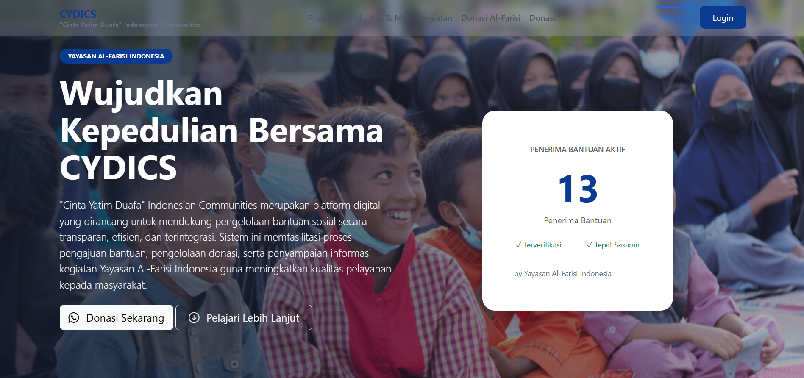
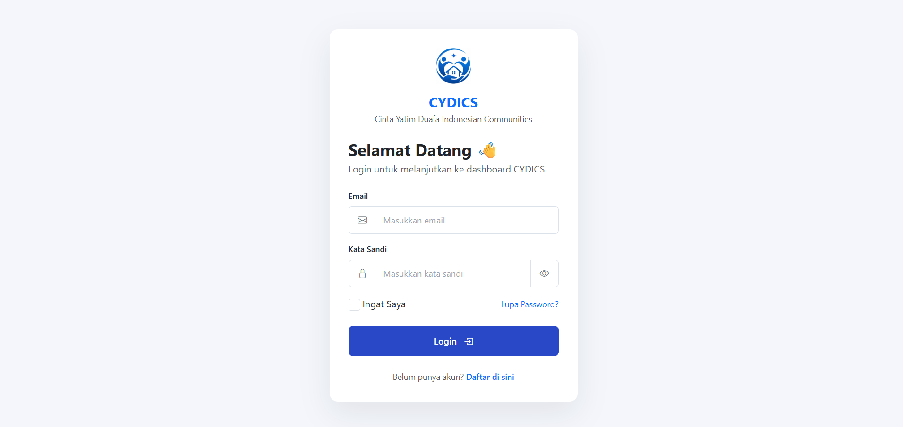
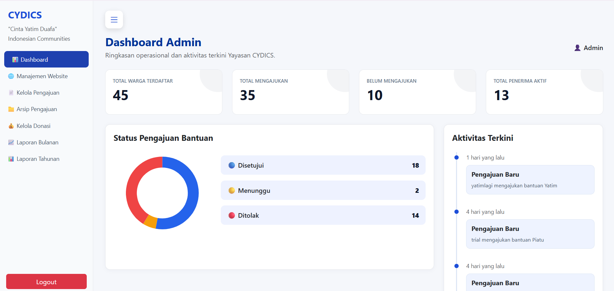
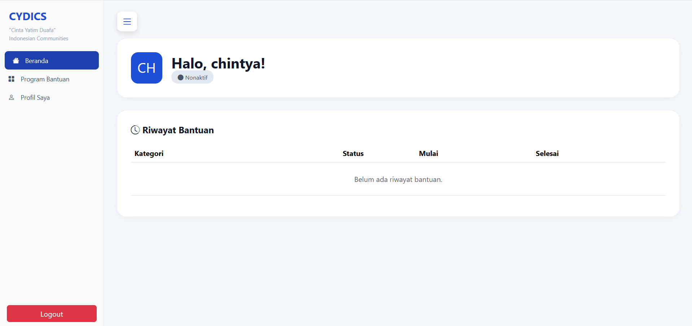
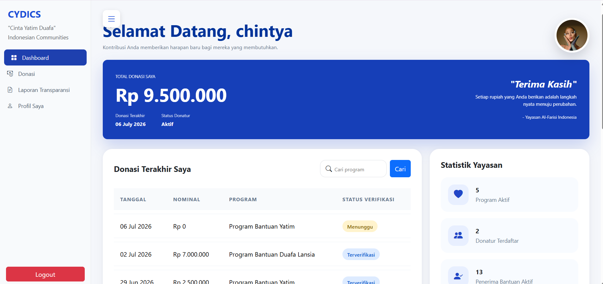
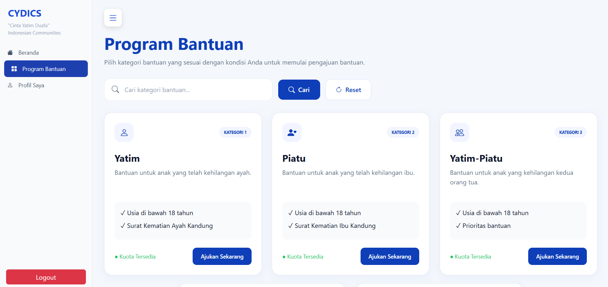
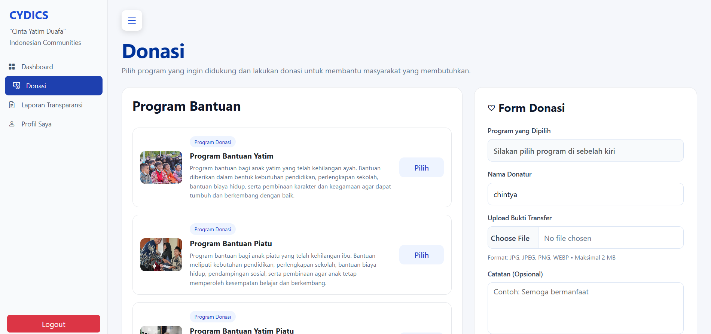
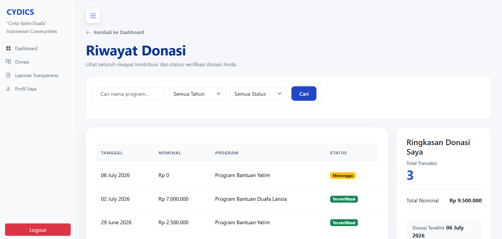
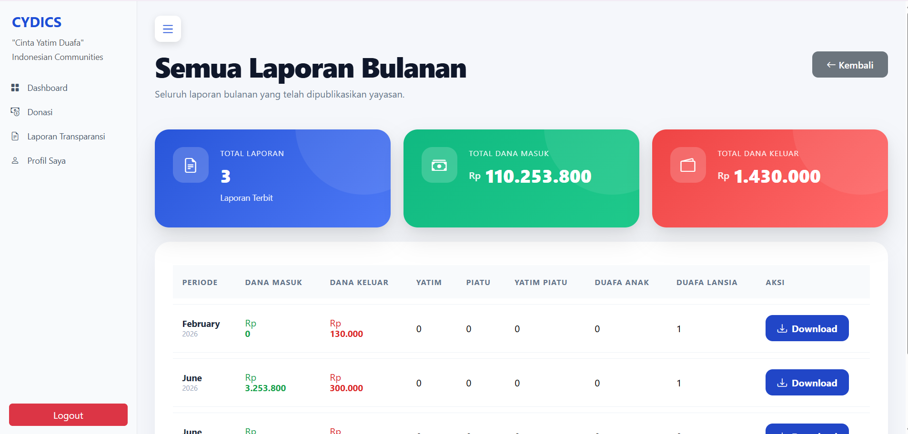
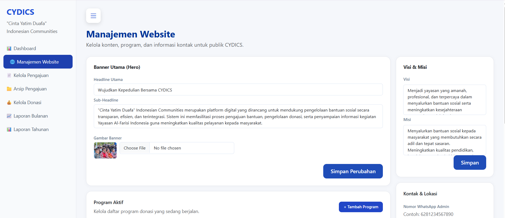

<h1 align="center">🌐 CYDICS</h1>

<h3 align="center">
Cinta Yatim Duafa Indonesian Communities
</h3>

<p align="center">
Web-Based Social Assistance Management System
</p>

<p align="center">


</p>

---

# 📖 About The Project

CYDICS (Cinta Yatim Duafa Indonesian Communities) is a web-based social assistance management system developed as a final project for **Yayasan Al-Farisi Indonesia**.

The system is designed to simplify the management of social assistance programs, beneficiary applications, donations, transparency reports, and foundation website content through a secure multi-role platform.

The application provides dedicated dashboards for administrators, beneficiaries, and donors while utilizing the **Decision Tree Algorithm** to support beneficiary eligibility classification.

---

# 🎯 Objectives

- Digitalize social assistance management.
- Improve transparency in donation reporting.
- Simplify beneficiary registration and verification.
- Assist administrators in managing foundation activities.
- Improve donation management.
- Support decision making using the Decision Tree algorithm.

---

# ✨ Main Features

## 🔐 Authentication

- Login
- Register
- Forgot Password
- Profile Management
- Role-Based Access Control

---

## 👤 Beneficiary

- Submit Social Assistance Application
- Upload Required Documents
- View Application Status
- Update Personal Profile
- View Assistance History

---

## ❤️ Donor

- Donate Online
- View Donation History
- View Transparency Reports
- View Foundation Activities

---

## 🛠 Administrator

- Manage Beneficiaries
- Verify Applications
- Manage Programs
- Manage Donations
- Manage Activities
- Manage Transparency Reports
- Manage Website Content
- Manage Annual Reports

---

# 🌳 Decision Tree Implementation

The Decision Tree algorithm is implemented to classify beneficiary eligibility based on several predefined criteria.

The classification process assists administrators in making objective decisions while reducing manual assessment.

---

# 🛠 Tech Stack

| Category | Technology |
|----------|------------|
| Backend | Laravel 13 |
| Programming Language | PHP |
| Database | MySQL |
| Frontend | HTML, CSS, JavaScript |
| CSS Framework | Bootstrap 5 |
| UI Design | Figma |
| Version Control | Git & GitHub |
| IDE | Visual Studio Code |

---

# 📸 Application Preview

## 🏠 Landing Page



---

## 🔐 Login Page



---

## 🛠 Admin Dashboard



---

## 👤 Beneficiary Dashboard



---

## ❤️ Donor Dashboard



---

## 📄 Social Assistance Application



---

## 💰 Donation Page



---

## 📜 Donation History



---

## 📊 Transparency Report



---

## 🌐 Website Management



# 📊 Repository Information

| Item | Description |
|------|-------------|
| Framework | Laravel 13 |
| Language | PHP |
| Database | MySQL |
| Architecture | MVC |
| Version Control | Git |
| Repository | GitHub |

# 🔒 Security Features

- Authentication
- Authorization
- Role-Based Access Control
- CSRF Protection
- Password Hashing
- Form Validation

# 🗄 Database

Main Database Tables

```
Users
Pengajuan
Donasi
Program
Kegiatan
Laporan
Laporan Tahunan
Website Settings
```

# 🏗 System Architecture

```text
          User
             │
             ▼
   Laravel Web Application
             │
             ▼
      MySQL Database
             │
             ▼
 Decision Tree Classification
             │
             ▼
    Application Dashboard
```


# 📂 Project Structure

```
app/
bootstrap/
config/
database/
public/
resources/
routes/
storage/
tests/
```

---

# 🚀 Installation

Clone Repository

```bash
git clone https://github.com/chintyabrillianti/cydics-web-application.git
```

Enter Project Directory

```bash
cd cydics-web-application
```

Install Dependencies

```bash
composer install
```

Copy Environment File

```bash
cp .env.example .env
```

Generate Application Key

```bash
php artisan key:generate
```

## Configure Environment

Update the `.env` file according to your local environment.

```env
DB_CONNECTION=mysql
DB_HOST=127.0.0.1
DB_PORT=3306
DB_DATABASE=your_database
DB_USERNAME=your_username
DB_PASSWORD=your_password
```

> **Note:** During development, this project used a MySQL database named `yayasan`.

Run Migration

```bash
php artisan migrate
```

Start Development Server

```bash
php artisan serve
```

---

# 📈 Future Improvements

- Payment Gateway Integration
- Email Notification
- Push Notification
- Mobile Application
- Dashboard Analytics
- Export PDF Reports
- Multi-Language Support
- API Integration

---

# 📄 License

This project was developed for educational purposes as a final project.

## 👩‍💻 Developer

**Chintya Ayu Brillianti**

Bachelor of Informatics Engineering

**Areas of Interest**

- Software Engineering
- UI/UX Design
- Mobile Development

📍 Bogor, Indonesia

📧 chintyabrillianti@gmail.com

🐙 GitHub: https://github.com/chintyabrillianti


# ⭐ Project Status

✅ Final Project Completed

🚀 Developed using Laravel Framework and MySQL Database.

## 🌐 Live Demo

Currently available for local development only.

Deployment to a public server is planned for a future release.


<p align="center">

Made with ❤️ using Laravel & MySQL

</p>